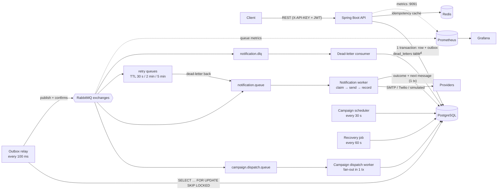
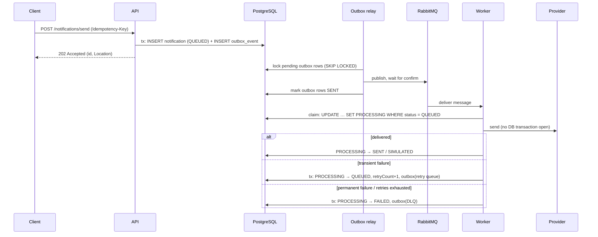
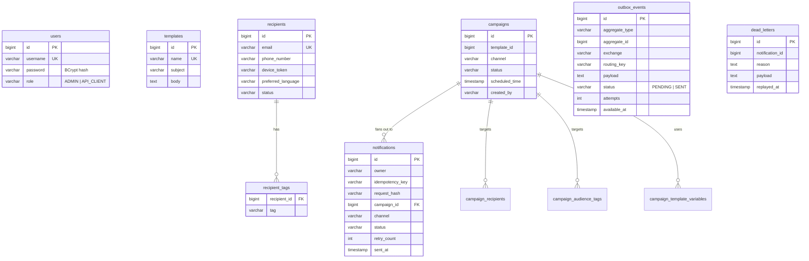

# RelayForge — Notification Delivery Platform

[](https://github.com/Vatsasarthak/RelayForge/actions/workflows/ci.yml)

> Formerly **Notifyr**. See [Upgrading from Notifyr](#upgrading-from-notifyr) if you run an installation created
> under the old name.

> Spring Boot service that accepts Email / SMS / (simulated) Push notifications and bulk campaigns over a REST API
> and delivers them asynchronously through RabbitMQ — with a transactional outbox, idempotent requests, bounded
> retries, a dead-letter queue, crash recovery, per-user authorization, metrics and a reproducible load test.

`Java 21` • `Spring Boot 3.5` • `PostgreSQL 16` • `RabbitMQ 3.13` • `Redis 7` • `Flyway` • `Testcontainers` • `k6` • `Prometheus` • `Grafana` • `Docker Compose`

---

## Contents

- [Features](#features)
- [Architecture](#architecture)
- [Delivery guarantees](#delivery-guarantees)
- [Retry strategy and failure handling](#retry-strategy-and-failure-handling)
- [Database design](#database-design)
- [Quick start (Docker Compose)](#quick-start-docker-compose)
- [Upgrading from Notifyr](#upgrading-from-notifyr)
- [Local development (VS Code on Windows)](#local-development-vs-code-on-windows)
- [Configuration](#configuration)
- [Authentication and authorization](#authentication-and-authorization)
- [API overview and examples](#api-overview-and-examples)
- [Observability](#observability)
- [Testing](#testing)
- [Performance](#performance)
- [Security](#security)
- [Design decisions (ADRs)](#design-decisions-adrs)
- [Troubleshooting](#troubleshooting)
- [Limitations and roadmap](#limitations-and-roadmap)

---

## Features

- **Notifications** — Email (SMTP/Mailtrap), SMS (Twilio), Push (simulated). `POST /notifications/send` sends email;
  SMS and Push are sent through campaigns.
- **Campaigns** — target explicit recipients or an audience (tags, language); send now or at `scheduledTime`;
  per-recipient template rendering (`{{name}}`, `{{email}}`, custom variables); delivery statistics per campaign.
- **Reliability** — transactional outbox, publisher confirms, idempotency keys (PostgreSQL unique index + Redis
  cache), atomic claim of each notification, retries after 30 s / 2 min / 5 min, dead-letter queue with
  inspection and replay, recovery of work abandoned by crashed workers, exactly-once campaign dispatch.
- **Security** — API key + JWT (BCrypt passwords); notifications are private to their creator; ADMIN-only
  management endpoints; the app refuses to start without strong secrets; actuator on a separate port.
- **API quality** — validation with field-level errors, one error format with correlation id, pagination
  (`page`, `size` ≤ 100, `sort`), `Location` headers, request bodies limited to 1 MB (`413`).
- **Observability** — correlation ids from HTTP through RabbitMQ into worker logs, optional JSON (ECS) logs,
  latency histograms (API, provider call, end-to-end delivery), outbox and queue-depth metrics, health checks,
  a provisioned Grafana dashboard.
- **Mock providers** — run everything locally without SMTP/Twilio credentials; simulated deliveries end in status
  `SIMULATED`, never `SENT`.

---

## Architecture



Every RabbitMQ message is first written to `outbox_events` **in the same database transaction** as the state change
that causes it, and published afterwards by the relay. The API therefore never talks to RabbitMQ directly and keeps
accepting requests while the broker is down.

### Request-to-delivery flow



### Notification states

```text
QUEUED ──claim──> PROCESSING ──> SENT | SIMULATED                 (delivered; final)
                      │     └──> QUEUED                           (transient failure, retry scheduled)
                      │     └──> FAILED                           (permanent failure or 4th failure)
                      └── lease expired (worker crashed) ──> QUEUED   (recovery job, counts as an attempt)
FAILED ──admin retry / dead-letter replay──> QUEUED
```

Campaigns: `DRAFT` / `SCHEDULED` → `RUNNING` (claimed atomically by a send) → `COMPLETED` (all notifications created
and queued, in one transaction) or `FAILED`. Delivery progress per campaign: `GET /campaigns/{id}/stats`.

---

## Delivery guarantees

| Guarantee | How |
|-----------|-----|
| An accepted request is never lost | Notification and its message are committed together (outbox); the relay retries publishing until the broker confirms |
| A retried request does not create a duplicate | `Idempotency-Key` → unique index `(owner, idempotency_key)`; a different body with the same key → 409 |
| A duplicate *message* does not cause a duplicate delivery | Atomic claim `QUEUED → PROCESSING` keyed by `(notification id, attempt)`; only one worker wins, and copies of an earlier attempt are ignored (no retry can skip its backoff) |
| A campaign is dispatched once | Compare-and-set `DRAFT/SCHEDULED → RUNNING`; fan-out under a row lock, only while `RUNNING` |
| Work abandoned by a crashed worker is finished | Recovery job re-queues `PROCESSING` rows older than the 5-minute lease and lost `QUEUED` rows, and re-dispatches campaigns stuck in `RUNNING` |
| Restarts do not abandon work | Graceful shutdown: HTTP requests, the current delivery of each consumer and the outbox batch finish (30 s budget, `stop_grace_period: 45s`); unacknowledged messages return to the queue |
| Failures terminate | At most 4 attempts, then `FAILED` + dead-letter queue; poison messages go to the DLQ, never loop |

**Not guaranteed — exactly-once external delivery.** If a worker dies after the provider accepted a message but
before the result was committed, the recovery job sends it again. Delivery to the provider is therefore
**at-least-once**; a duplicate needs that crash window. Providers that support idempotency keys could close it
(not implemented). See [ADR 0003](docs/adr/0003-at-least-once-delivery.md).

---

## Retry strategy and failure handling

| Failure | Behaviour |
|---------|-----------|
| Provider error (SMTP timeout, Twilio 5xx/429, …) | `QUEUED` with `retryCount+1`, retry after 30 s, then 2 min, then 5 min; 4th failure → `FAILED` + DLQ |
| Permanent error (no email/phone/device token, provider not configured, Twilio 4xx) | `FAILED` immediately + DLQ, no retries |
| RabbitMQ down or unreachable | API keeps returning 202; messages wait in `outbox_events`; relay retries with backoff 1 s → 60 s; health `outbox` turns DOWN after 5 min |
| Worker crash during delivery | Message is redelivered (unacked) but the row is `PROCESSING`; after the lease (5 min) the recovery job re-queues it |
| Unexpected listener error (e.g. DB down) | 3 in-process attempts (1 s, 2 s), then the message is republished to the DLQ; the recovery job later re-queues the notification |
| Unreadable (poison) message | Same as above → DLQ → recorded in `dead_letters` |
| Redis down or hung | Logged; each cache call gives up after 1 s (`spring.data.redis.timeout`), idempotency falls back to PostgreSQL, requests still succeed. The `redis` health component reports DOWN meanwhile |
| Hung broker (network partition) | 10 s heartbeat and RPC timeouts fail the publish instead of blocking for the client default of 10 min |

Dead letters are consumed into the `dead_letters` table (`GET /admin/dead-letters`) and can be replayed
(`POST /admin/dead-letters/{id}/replay`) once the cause is fixed. A single failed notification can also be retried
with `POST /notifications/{id}/retry`.

---

## Database design

Schema is managed by Flyway (`src/main/resources/db/migration`, V1–V3); Hibernate only validates it.



Indexes that back the hot paths:

| Index | Used by |
|-------|---------|
| `uq_notifications_owner_idempotency_key` (unique, partial) | idempotency check and race resolution |
| `idx_notifications_owner_created (owner, created_at DESC, id DESC)` | `GET /notifications` (newest first per user) |
| `idx_notifications_status_updated (status, updated_at)` | recovery job (stale `PROCESSING` / `QUEUED`) |
| `idx_notifications_campaign_status` (partial) | `GET /campaigns/{id}/stats` |
| `idx_outbox_pending (available_at, id) WHERE status = 'PENDING'` | outbox relay poll |
| `idx_campaigns_status_scheduled_time` | scheduler |

`CHECK` constraints mirror every enum column. Status changes that race (claim, delivery outcome, campaign send)
are conditional `UPDATE … WHERE status = …` statements rather than read-modify-write.

---

## Quick start (Docker Compose)

Prerequisites: **Docker Desktop**. Run from the folder that contains `pom.xml`.

```powershell
Copy-Item .env.example .env
notepad .env                    # replace every "change-me" value; change ports that are already in use
docker compose up -d --build
docker compose ps               # wait for relayforge_app "(healthy)"
```

| Service | URL | Login |
|---------|-----|-------|
| API | http://localhost:8080 | `X-API-KEY` + JWT |
| Swagger UI | http://localhost:8080/swagger-ui.html | **Authorize** with API key and Bearer token |
| Health / metrics | http://localhost:9091/actuator/health, /actuator/prometheus | none (localhost only) |
| RabbitMQ management | http://localhost:15672 | `RABBITMQ_DEFAULT_USER` / `RABBITMQ_DEFAULT_PASS` |
| Prometheus | http://localhost:9090 | none |
| Grafana (dashboard "RelayForge overview") | http://localhost:3000 | `GRAFANA_ADMIN_USER` / `GRAFANA_ADMIN_PASSWORD` |

Use your `.env` ports if you changed the defaults.

```powershell
docker compose logs -f app      # application logs
docker compose stop             # stop, keep everything
docker compose down             # remove containers, keep the database volume
```

`docker compose down -v` also deletes the database volume (**all data**).

---

## Upgrading from Notifyr

The rename changed the Docker Compose project from `notifyr` to `relayforge`. Compose prefixes volume and network
names with the project name, so without action a renamed stack starts with **new, empty** volumes
(`relayforge_postgres_data`, …). The old volumes are not deleted; they are just no longer used.

To keep an existing installation's data:

1. Keep your existing `.env` (its `POSTGRES_*` / `RABBITMQ_*` values are the ones the database and broker were
   initialised with) and add:
   ```
   COMPOSE_PROJECT_NAME=notifyr
   RABBITMQ_HOSTNAME=notifyr-rabbitmq
   ```
   `COMPOSE_PROJECT_NAME` selects the old volumes (`notifyr_postgres_data`, `notifyr_rabbitmq_data`) and network;
   `RABBITMQ_HOSTNAME` keeps the broker's node name, under which RabbitMQ stores its queues and messages.
2. Remove the old containers **without** `-v`: `docker compose down`. Container names changed (`notifyr_*` →
   `relayforge_*`), so the old containers would otherwise keep holding the ports.
3. `docker compose up -d --build`

Unchanged by the rename, so existing data and clients keep working: database schema and Flyway history, queue and
exchange names, API routes, environment variable names, the Java package `com.vatsasarthak.notifyr`, and the AMQP
header `x-notifyr-failure-reason` (stored in pending outbox rows and dead-lettered messages).
`NOTIFYR_ENV_FILE` is still honoured; the new name is `RELAYFORGE_ENV_FILE`.

Changed: container names (`relayforge_*`), image (`relayforge-app:local`), Prometheus job (`relayforge`), Grafana
dashboard (uid `relayforge-overview`), the container user, the jar name (`relayforge-0.0.1-SNAPSHOT.jar`), the
`[RelayForge]` application name in log lines, and the example database/user names in `.env.example`. Prometheus and
Grafana keep no volume in this Compose file, so their history starts fresh either way.

---

## Local development (VS Code on Windows)

Prerequisites: JDK 21, Docker Desktop, VS Code with *Extension Pack for Java* and *Spring Boot Extension Pack*.
Maven is not needed (`mvnw.cmd` is included).

```powershell
cd <path-to-checkout>                     # the folder with pom.xml - open THIS folder in VS Code
Copy-Item .env.example .env               # first time only, then edit it
docker compose up -d postgres rabbitmq redis
.\mvnw.cmd spring-boot:run                # or: Run on RelayForgeApplication.java in VS Code
```

The app reads `.env` from the working directory (`spring.config.import`; `RELAYFORGE_ENV_FILE` points it at another
file), so the same file serves Docker and local runs; real environment variables win. If the `relayforge_app`
container is running too, stop it first
(`docker compose stop app`) because both use `APP_PORT` / `MANAGEMENT_PORT`.

---

## Configuration

Everything is set through environment variables; `.env.example` documents each one. The important ones:

| Variable | Default | Purpose |
|----------|---------|---------|
| `API_KEY`, `JWT_SECRET` | — (required) | API key header value; JWT HMAC key (≥ 32 bytes). The app does not start without them |
| `BOOTSTRAP_ADMIN_USERNAME`, `BOOTSTRAP_ADMIN_PASSWORD` | empty | first ADMIN, created at startup while none exists (password 12–72 chars) |
| `POSTGRES_*`, `RABBITMQ_DEFAULT_*`, `GRAFANA_ADMIN_PASSWORD` | — (required) | infrastructure credentials |
| `MOCK_PROVIDER` | app `false`, Compose `true` | log email/SMS instead of sending; status `SIMULATED` |
| `MAIL_*`, `TWILIO_*` | Mailtrap host, empty | real providers |
| `APP_PORT`, `MANAGEMENT_PORT`, `*_PORT` | 8080, 9091, … | host ports |
| `WORKER_CONCURRENCY` / `WORKER_MAX_CONCURRENCY` | 4 / 8 | notification consumer threads |
| `DB_POOL_SIZE` | 20 | Hikari pool size |
| `MAX_REQUEST_BODY_SIZE` | 1MB | larger request bodies are rejected with `413` |
| `COMPOSE_PROJECT_NAME`, `RABBITMQ_HOSTNAME` | `relayforge`, `relayforge-rabbitmq` | set to `notifyr`, `notifyr-rabbitmq` to keep a pre-rename installation's volumes ([details](#upgrading-from-notifyr)) |
| `MOCK_PROVIDER_DELAY_MS` | 0 | artificial mock-provider latency (load tests) |
| `RETRY_TTL_30S_MS`, `RETRY_TTL_2M_MS`, `RETRY_TTL_5M_MS` | 30000 / 120000 / 300000 | retry delays |
| `PROCESSING_LEASE` | `PT5M` | time after which a `PROCESSING` notification is considered abandoned |
| `SIMULATE_FAILURE_RATE` | 0.0 | fraction of deliveries that fail on purpose (exercise retries/DLQ) |
| `APP_TIMEZONE` | UTC | container time zone; `scheduledTime` is interpreted in it |
| `LOGGING_STRUCTURED_FORMAT_CONSOLE` | unset | `ecs` switches to JSON logs (add it to the app's `environment` in `docker-compose.yml`) |

Generate secrets in PowerShell:
`$b = New-Object byte[] 48; [Security.Cryptography.RandomNumberGenerator]::Create().GetBytes($b); [Convert]::ToBase64String($b)`

---

## Authentication and authorization

| Endpoint group | Requires |
|----------------|----------|
| `/auth/**`, `/swagger-ui/**`, `/v3/api-docs/**` | nothing |
| `/notifications/**` | `X-API-KEY` **and** a JWT (any role); users only see their own notifications |
| `GET` recipients / templates / campaigns | `X-API-KEY` |
| `POST`/`PUT`/`DELETE` recipients / templates / campaigns, `/admin/**`, `POST /notifications/{id}/retry` | `X-API-KEY` **and** an `ADMIN` JWT |

`401` = missing/invalid API key or token; `403` = valid token without the role; another user's notification → `404`.
**Administrators:** the public `/auth/register` never grants `ADMIN` — only a request carrying an ADMIN token can
create another admin. The first ADMIN is created at startup from `BOOTSTRAP_ADMIN_USERNAME` /
`BOOTSTRAP_ADMIN_PASSWORD` while no ADMIN exists ([ADR 0006](docs/adr/0006-admin-bootstrap.md)).
`API_CLIENT` users can always register. See [ADR 0004](docs/adr/0004-notification-ownership.md).

---

## API overview and examples

| Method | Path | Access | Description |
|--------|------|--------|-------------|
| POST | `/auth/register`, `/auth/login` | public | create user / get JWT (1 h) |
| POST | `/notifications/send` | user | queue an email; optional `Idempotency-Key`; `202` + `Location` |
| GET | `/notifications?status=&page=&size=&sort=` | user | own notifications, newest first (ADMIN: all) |
| GET | `/notifications/{id}` | user | status, retries, failure reason, `sentAt` |
| POST | `/notifications/{id}/retry` | ADMIN | re-queue a `FAILED` notification |
| POST/GET/PUT/DELETE | `/recipients`, `/recipients/{id}`, `PUT /recipients/{id}/status` | GET: key, rest: ADMIN | recipients (`?search=` by name/email) |
| POST/GET/PUT | `/templates`, `/templates/{id}` | GET: key, rest: ADMIN | templates |
| POST/GET/PUT/DELETE | `/campaigns`, `/campaigns/{id}` | GET: key, rest: ADMIN | campaigns |
| POST | `/campaigns/{id}/send` | ADMIN | dispatch now (`409` if already sent) |
| GET | `/campaigns/{id}/stats` | key | notification counts by status |
| GET | `/admin/dead-letters` | ADMIN | dead-letter records |
| POST | `/admin/dead-letters/{id}/replay` | ADMIN | re-queue the dead-lettered notification |

Lists return `{"content": [...], "page", "size", "totalElements", "totalPages"}`. Client errors keep their 4xx
status (`400` validation, `401`/`403`, `404`, `405`, `409` conflicts, `413` body over `MAX_REQUEST_BODY_SIZE`,
`415` unsupported `Content-Type`); only unexpected failures are `500`. Errors:

```json
{"timestamp": "2026-10-11T12:00:00Z", "status": 400, "error": "Validation failed",
 "path": "/notifications/send", "correlationId": "4f1c…", "details": {"recipientEmail": "must be a valid email address"}}
```

### PowerShell walkthrough

```powershell
$base = "http://localhost:8080"; $key = "<your API_KEY>"

# log in as the bootstrap admin (BOOTSTRAP_ADMIN_USERNAME / BOOTSTRAP_ADMIN_PASSWORD from .env)
$login = @{ username = "admin"; password = "<your BOOTSTRAP_ADMIN_PASSWORD>" } | ConvertTo-Json
$token = (Invoke-RestMethod "$base/auth/login" -Method Post -ContentType "application/json" -Body $login).token
$h = @{ "X-API-KEY" = $key; Authorization = "Bearer $token" }

# send an email idempotently and follow its status
$mail = @{ recipientEmail = "jane@example.com"; subject = "Hello"; message = "First message" } | ConvertTo-Json
$n = Invoke-RestMethod "$base/notifications/send" -Method Post -ContentType "application/json" `
       -Headers ($h + @{ "Idempotency-Key" = "order-1001" }) -Body $mail
Invoke-RestMethod "$base/notifications/$($n.id)" -Headers $h

# campaign: template + recipient + send + stats
$tpl = @{ name = "welcome"; subject = "Welcome {{name}}"; body = "Hi {{name}}, use code {{code}}." } | ConvertTo-Json
$t = Invoke-RestMethod "$base/templates" -Method Post -ContentType "application/json" -Headers $h -Body $tpl
$r = @{ name = "Jane"; email = "jane@example.com"; phoneNumber = "+15550001111"; tags = @("premium") } | ConvertTo-Json
Invoke-RestMethod "$base/recipients" -Method Post -ContentType "application/json" -Headers $h -Body $r
$c = @{ name = "Launch"; channel = "EMAIL"; templateId = $t.id; audienceTags = @("premium");
        templateVariables = @{ code = "LAUNCH10" } } | ConvertTo-Json
$c = Invoke-RestMethod "$base/campaigns" -Method Post -ContentType "application/json" -Headers $h -Body $c
Invoke-RestMethod "$base/campaigns/$($c.id)/send" -Method Post -Headers $h
Invoke-RestMethod "$base/campaigns/$($c.id)/stats" -Headers @{ "X-API-KEY" = $key }
```

Phone numbers must be E.164 (`+15551234567`). `scheduledTime` (e.g. `"2030-01-01T09:00:00"`) schedules a campaign.

---

## Observability

- **Correlation ids** — every response carries `X-Correlation-Id` (the caller's, if well-formed, or a new UUID).
  It is stored with outbox events, sent as an AMQP header, and put in the logging MDC by the workers, so
  `docker compose logs app | Select-String <id>` shows the request *and* its delivery. Error bodies include it.
- **Logs** — `[correlationId]` in every line; `LOGGING_STRUCTURED_FORMAT_CONSOLE=ecs` switches to JSON (ECS).
- **Metrics** (`:9091/actuator/prometheus`):

  | Metric | Meaning |
  |--------|---------|
  | `http_server_requests_seconds` (histogram) | API latency per endpoint/status |
  | `notification_delivery_latency_seconds` (histogram) | accepted → delivered, incl. retries |
  | `notification_provider_duration_seconds` (histogram) | provider call duration by channel/outcome |
  | `notifications_sent_total`, `notifications_simulated_total`, `notifications_failed_total{reason}` | outcomes |
  | `retry_attempts_total`, `dead_letter_messages_total`, `notifications_recovered_total{reason}`, `notifications_duplicate_messages_total` | reliability events |
  | `outbox_events_pending`, `outbox_oldest_pending_age_seconds`, `outbox_events_published_total`, `outbox_events_publish_failures_total` | outbox backlog |
  | `rabbitmq_detailed_queue_messages_ready{queue}` (from RabbitMQ) | queue depth incl. DLQ |

- **Health** — `:9091/actuator/health`; components `db`, `rabbit`, `redis`, `outbox` (DOWN when the oldest
  unpublished message is > 5 min old) are shown with an ADMIN token.
- **Grafana** — dashboard *RelayForge overview* (provisioned): API rate and p50/p95/p99, delivery outcomes, end-to-end
  latency, outbox backlog, queue depth, dead letters/recovery, provider latency.

---

## Testing

```powershell
.\mvnw.cmd clean verify     # unit + integration tests, then the jar (Docker must be running)
```

CI: [`.github/workflows/ci.yml`](.github/workflows/ci.yml) runs the same `clean verify` (incl. Testcontainers),
validates `docker-compose.yml` and builds the Docker image on every push to `main` and every pull request.

110 tests (JUnit 5, Mockito, Testcontainers with real PostgreSQL 16, RabbitMQ 3.13 and Redis 7):

| Area | Tests |
|------|-------|
| API end to end (`ApiIntegrationTest`) | auth, roles (401 vs 403), cross-user isolation, validation, `413`/`415`, pagination, idempotency incl. body mismatch, campaigns and stats, scheduler, actuator, correlation ids |
| Reliability (`ReliabilityIntegrationTest`) | 10 duplicate messages → 1 provider call; stale earlier-attempt message → ignored; 20 concurrent same-key requests → 1 row; 10 concurrent campaign sends → 1 dispatch; broker paused → requests accepted, delivered after recovery; Redis paused → idempotent requests still answered within seconds and deduplicated; crashed-worker, lost-message and stuck-campaign recovery |
| Retries / DLQ (`RetryAndDeadLetterIntegrationTest`) | real TTL retry topology → `FAILED` after 4 attempts → dead-letter record → replay; poison message → DLQ, no loop |
| Schema (`RelayForgeApplicationTests`) | Flyway migrations on an empty database validate against the JPA model |
| Unit | state machine, worker outcomes, outbox relay and backoff, idempotency (Redis down, races), campaigns, auth and admin bootstrap, JWT, log masking, correlation and request-size filters, templates |

Integration tests are skipped (reported as skipped) when Docker is not running. They never read your `.env`.

---

## Performance

A reproducible k6 load test lives in [`perf/`](perf/README.md): it drives `POST /notifications/send` at a constant
arrival rate, waits until every accepted notification is delivered, and computes end-to-end delivery latency from
PostgreSQL. Methodology, environment and all results are in **[perf/README.md](perf/README.md)**.

Measured on 2026-10-11 (before the rename and later changes, which were not re-measured) on one laptop (Ryzen 5
5600H, everything incl. k6 in Docker Desktop), 60 s per rate, mock email provider:

| Rate | API p95 | Errors | Accepted → delivered p95 | Backlog drained after load |
|---:|---:|---:|---:|---:|
| 100 req/s | 6.1 ms | 0 % | 113 ms | 1.0 s |
| 500 req/s | 12.8 ms | 0 % | 145 ms | 1.0 s |
| 1000 req/s | 67.9 ms | 0 % | 21.7 s (delivery ≈ 690/s, backlog queued) | 26.7 s |
| 2000 req/s | 1.5 s (API saturated, ≈ 1,650 accepted/s) | 0 % | 140 s | 142.5 s |

Every accepted notification was delivered in every run. The single-threaded outbox relay is the first bottleneck.

```powershell
docker compose up -d
.\perf\run-load-test.ps1 -Rate 100 -Duration 60s
```

---

## Security

- **Secrets** come only from the environment / `.env` (git-ignored); the app refuses to start without `API_KEY` and a
  JWT secret of at least 32 bytes and warns while `.env.example` placeholders are in use. No credentials are in the
  repository.
- **Passwords** are BCrypt-hashed (8–72 characters). The public registration endpoint cannot create administrators
  ([ADR 0006](docs/adr/0006-admin-bootstrap.md)).
- **Request size**: bodies over `MAX_REQUEST_BODY_SIZE` (1 MB) are rejected with `413` before authentication and
  before they are parsed, whether or not the client sends `Content-Length`.
- **Authorization**: API key on every business endpoint, JWT roles for writes, per-user notification ownership
  (404 for other users' notifications).
- **Exposure**: actuator only on the management port; PostgreSQL, RabbitMQ, Redis, Prometheus and Grafana are bound
  to `127.0.0.1` in Docker Compose; the app container runs as a non-root user.
- **Logs** mask personal data (`j***@example.com`, `+1*******567`, device tokens reduced to a prefix) and never
  contain passwords, tokens or keys. Error responses never include stack traces.
- **SQL** is generated by JPA / parameterised `@Query` statements only; no string-built SQL.
- **Dependencies** were checked against [OSV.dev](https://osv.dev) on 2026-10-18 (175 resolved artifacts, all
  scopes). Patched versions are pinned in `pom.xml`; the only open advisories are two Spring Framework 6.2 issues
  fixed only in 7.0 (CVE-2026-47890 SSE fragment rendering, CVE-2026-47884 `XsltView`). RelayForge is a JSON-only
  API and uses neither feature; upgrading to Spring Boot 4 removes them. Re-run such a check regularly (e.g. GitHub
  Dependabot).

Not covered: login rate limiting / account lockout, token revocation, TLS termination (expected at a reverse proxy),
Redis authentication (Redis is bound to localhost in Compose), CORS (none configured, so browsers on other origins
cannot call the API), and Swagger UI / OpenAPI docs are served without authentication.

---

## Design decisions (ADRs)

1. [Transactional outbox](docs/adr/0001-transactional-outbox.md)
2. [Idempotency keys: PostgreSQL as source of truth, Redis as cache](docs/adr/0002-idempotency-keys.md)
3. [At-least-once delivery: claims, leases, recovery](docs/adr/0003-at-least-once-delivery.md)
4. [Notifications belong to the authenticated user](docs/adr/0004-notification-ownership.md)
5. [Actuator on a separate management port](docs/adr/0005-management-port.md)
6. [The first administrator comes from configuration](docs/adr/0006-admin-bootstrap.md)

---

## Troubleshooting

| Symptom | Fix |
|---------|-----|
| `port is already allocated` | change `APP_PORT`, `MANAGEMENT_PORT`, `POSTGRES_PORT`, … in `.env`, then `docker compose up -d` |
| `Set API_KEY in .env` from Compose | `.env` missing or incomplete — copy `.env.example` |
| App exits: `JWT_SECRET … must be set` / `at least 32 bytes` | set strong values in `.env` |
| Local app: `password authentication failed` | it reached another PostgreSQL (e.g. a native install on 5432) — set `POSTGRES_PORT` to a free port and recreate the container |
| Local app ignores `.env` | start it from the folder that contains `.env` |
| `FATAL: invalid value for parameter "TimeZone"` | handled for known legacy zone ids; otherwise start the JVM with `-Duser.timezone=UTC` |
| `PRECONDITION_FAILED … x-message-ttl` | an existing broker has retry queues with other TTLs — delete the `notification.retry.*` queues in the RabbitMQ UI |
| Notification stays `QUEUED` | check `outbox_events_pending` / health `outbox` (broker reachable?) and `docker compose logs app` |
| `SIMULATED` instead of `SENT` | mock mode (`MOCK_PROVIDER=true`) or Push |
| Tests fail with "Unresolved compilation problem" | VS Code's Java server wrote into `target/`; run `.\mvnw.cmd clean verify` |
| Integration tests skipped | start Docker Desktop |

---

## Limitations and roadmap

- Delivery to providers is at-least-once (see guarantees); no provider-side idempotency keys.
- Push is simulated; `POST /notifications/send` is email only.
- Campaign fan-out loads the whole audience and writes it in one transaction — fine for thousands of recipients,
  not for millions (would need batching/streaming).
- Outbox polling adds up to ~100 ms before publication; one relay thread per instance limits delivery to roughly
  700 notifications/s on the test laptop (see Performance).
- Exact page counts (`totalElements`) cost a scan of the user's rows; fine for normal users, ~30 ms for a user with
  100k notifications.
- `scheduledTime` has no time zone; JWTs cannot be revoked before expiry; one shared API key; no login rate limiting.
- A campaign whose fan-out failed permanently (e.g. its template was deleted) ends `FAILED` and cannot be re-sent.
- Published outbox rows are deleted after 24 h; dead letters are kept until removed manually.
- No rate limiting or per-tenant quotas.
- A Redis outage turns the overall health status DOWN (the `redis` component), although requests keep working
  without the cache.

Roadmap: dedicated per-channel queues, FCM push, provider idempotency keys, batched campaign fan-out, rate limiting,
webhooks for delivery status.

---

## Project structure

The Java package is still `com.vatsasarthak.notifyr`: it was deliberately not renamed with the product.

```text
src/main/java/com/vatsasarthak/notifyr/
├── config/      security, RabbitMQ, Redis, OpenAPI, API-key + correlation-id filters, outbox health
├── controller/  REST endpoints (incl. AdminController)
├── dto/         requests/responses, PageResponse, ErrorResponse
├── entity/      JPA entities and enums (NotificationStatus state machine, OutboxEvent, DeadLetter)
├── exception/   domain exceptions and the global error handler
├── provider/    SMTP, Twilio and mock providers
├── repository/  Spring Data repositories (conditional updates, SKIP LOCKED queries)
├── scheduler/   campaign scheduler, recovery job
├── security/    JWT utility/filter, CurrentUser
├── service/     business logic, NotificationLifecycleService, OutboxService
└── worker/      notification worker, campaign dispatch worker, outbox relay, dead-letter consumer
src/main/resources/db/migration/   Flyway V1–V3
docs/adr/                          architecture decision records
perf/                              k6 load test, runner script, results
grafana/provisioning/              datasource + dashboard
```
